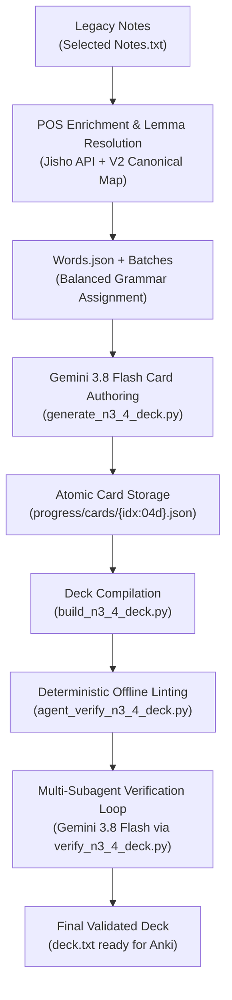

# Japanese Anki Deck Migration & Generation Skill

This skill provides the definitive engineering and linguistic workflow for migrating legacy Anki Japanese vocabulary notes into production-grade, 15-field active recall decks paired with JLPT grammar points.

## Core Principles & Hard Invariants

1. **Preserve Learning History via GUID Matching**:
   - The first column must always be the original note GUID (`#guid column:1`).
   - The header block must preserve `#deck:日语::大家的日语::单词` (or target deck name).
   - This ensures Anki updates existing note fields without resetting SRS scheduling intervals, ease factors, or review history.
2. **Audio Drop Policy**:
   - Both `WordAudio` and `SentenceAudio` fields MUST be strictly empty strings `""`.
   - Never generate or retain obsolete sound filenames (e.g. `[sound:xxx.mp3]`). Audio will be bulk-generated by the user later via HyperTTS.
3. **Grammar.json is Strictly Read-Only**:
   - Under no circumstances should `Grammar.json` be rewritten, edited, or reordered by automated scripts.
   - Use `Grammar.json` as an immutable source of truth for grammar patterns, connection forms, IDs, and meanings.
4. **Authentic Orthography & Shinjitai**:
   - Sentences must use standard modern Japanese Shinjitai (新字体). Never leak Simplified Chinese characters (e.g., use 関, 発, 気, 開, 車, 会, 見, 報).
   - `Sentence` text must be clean, natural Japanese (no ruby brackets `[...]` or HTML).
   - Ruby furigana `Kanji[furigana]` is restricted exclusively to the `Furigana` field.

---

## The 15-Field Production Schema

Every card must populate exactly the following 15 tab-separated fields:

| # | Field Name | Description & Requirement |
| :--- | :--- | :--- |
| 1 | `Word` | Clean canonical lemma (e.g., `止まる`, `コップ`, `安心`) |
| 2 | `Reading` | Pure kana reading (e.g., `とまる`, `コップ`, `あんしん`) |
| 3 | `Furigana` | Ruby bracket format (e.g., `止[と]まる`, `安心[あんしん]`) |
| 4 | `POS` | Enriched Japanese standard POS (e.g., `他動1`, `自動2`, `名・他動3`, `イ形`, `ナ形`, `副`, `連語・表現`) |
| 5 | `Meaning` | Accurate, concise Chinese definition |
| 6 | `WordAudio` | Strictly empty `""` |
| 7 | `Sentence` | Natural, authentic Japanese sentence integrating target word + grammar pattern |
| 8 | `SentenceAudio` | Strictly empty `""` |
| 9 | `SentenceTranslation` | Polished, idiomatic Chinese translation |
| 10 | `WordUsage` | Detailed Chinese syntactic explanation (subject/object role, collocations, nuances) |
| 11 | `GrammarPattern` | Target grammar pattern (e.g., `～さ`, `～あまり～ない`) |
| 12 | `GrammarMeaning` | Deep Chinese explanation of grammar function and nuances |
| 13 | `GrammarUsage` | Structural connection form (辞書形, 連用形, etc.) and role in this sentence |
| 14 | `CombinationLogic` | Contextual rationale explaining why word + grammar naturally co-occur |
| 15 | `Tags` | Formatted tags: `N3_4::Vocabulary N3_4::Grammar::{id} {original_tags}` |

---

## Migration Architecture & Workflow



---

## Step-by-Step Execution Guide

### Phase 1: Term Normalization & POS Enrichment
1. Parse legacy notes (`Selected Notes.txt`).
2. Legacy `V2` notes frequently have mangled polite forms, kana/kanji mixtures, or trailing collocations. Use an explicit dictionary `V2_GUID_CANONICAL` to normalize words into dictionary lemmas.
3. Query free dictionary APIs (such as Jisho.org) with rate-limiting to enrich missing or non-standard POS tags, saving to `pos_cache.json`.
4. Run `python3 scripts/prepare_n3_4_words.py` to generate `Words.json` with deterministic grammar pairing (`grammar_list[idx % len(grammar_list)]`).

### Phase 2: Card Authoring with Gemini 3.8 Flash
1. Ensure `GOOGLE_API_KEY` is exported in `~/.zshrc` or environment.
2. Run `scripts/generate_n3_4_deck.py` using `google-genai` SDK:
   ```bash
   python3 -u scripts/generate_n3_4_deck.py --batch-size 6 --rpm 1000
   ```
3. Cards are validated and saved atomically to `progress/cards/{idx:04d}.json`.

### Phase 3: Compilation & Deterministic Linter
1. Compile cards into Anki TSV format:
   ```bash
   python3 scripts/build_n3_4_deck.py
   ```
2. Verify TSV formatting, 16-column count, and GUID integrity:
   ```bash
   python3 scripts/validate_n3_4_deck.py
   ```
3. Run the offline deterministic linter to catch kana/kanji discrepancies and Simplified Chinese characters:
   ```bash
   python3 scripts/agent_verify_n3_4_deck.py
   ```

### Phase 4: Multi-Subagent Gemini 3.8 Linguistic Verification Loop
1. Partition the deck into balanced chunks (e.g., 4 partitions for 556 cards).
2. Launch parallel subagents where each subagent evaluates batches of 15 cards per prompt (`DEFAULT_BATCH_SIZE = 15`):
   ```bash
   # Subagent Partition 1
   python3 -u scripts/verify_n3_4_deck.py --indices 0-139 --cache-file N3_4_Level/progress/.verify_cache_part1.json --report-file N3_4_Level/progress/verification_report_part1.json --no-recompile --force

   # Subagent Partition 2
   python3 -u scripts/verify_n3_4_deck.py --indices 140-279 --cache-file N3_4_Level/progress/.verify_cache_part2.json --report-file N3_4_Level/progress/verification_report_part2.json --no-recompile --force

   # Subagent Partition 3
   python3 -u scripts/verify_n3_4_deck.py --indices 280-419 --cache-file N3_4_Level/progress/.verify_cache_part3.json --report-file N3_4_Level/progress/verification_report_part3.json --no-recompile --force

   # Subagent Partition 4
   python3 -u scripts/verify_n3_4_deck.py --indices 420-555 --cache-file N3_4_Level/progress/.verify_cache_part4.json --report-file N3_4_Level/progress/verification_report_part4.json --no-recompile --force
   ```
3. Once all subagents report completion, recompile and perform a final validation:
   ```bash
   python3 scripts/build_n3_4_deck.py
   python3 scripts/validate_n3_4_deck.py
   python3 scripts/agent_verify_n3_4_deck.py
   ```

---

## Anki Import Runbook

When importing the final `deck.txt` into Anki:
1. File -> Import -> select `N3_4_Level/deck.txt`.
2. Ensure Note Type is set to `日文单词` (15 fields).
3. **Important Import Settings**:
   - Field separator: `Tab`
   - Existing notes: **"Update existing notes when first field matches"**
   - Match scope: **"First field"** (GUID)
4. Click **Import**. Anki will update all notes in-place without resetting review histories or ease intervals.
5. In Anki, select the updated notes and run HyperTTS to batch-synthesize `WordAudio` and `SentenceAudio`.
